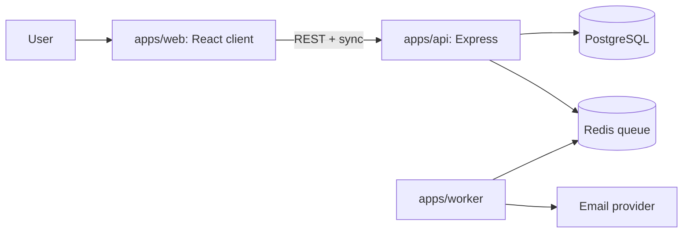

# Architecture

Last reviewed: 2026-11-01. Owner: platform team.

## Overview

TaskFlow is a client-server app. The web client works offline and syncs with
the API. The API owns business rules and talks to PostgreSQL.

## System diagram

## Components

| Component | Owns | Must not |
| --- | --- | --- |
| apps/web | UI, local store, sync client | Contain business rules |
| apps/api routes | HTTP parsing, auth, validation | Query the database directly |
| apps/api services | Business logic, transactions | Know about HTTP |
| apps/worker | Emails, webhooks, retries | Serve user requests |
| packages/shared | Types and zod schemas | Import from any app |

## Key flow: offline sync

1. Client writes changes to its local store with a version stamp.
2. When online, client sends a batch to `POST /v1/sync`.
3. API selects the value with the later hybrid-logical-clock stamp per field;
   same-field concurrent edits may lose a value, subject to history retention.
4. After the server acknowledges changes, the client reconciles local state,
   persists any returned history/conflicts and removes acknowledged queue items.

## Rules

- Dependency direction: routes -> services -> repositories. Never upward.
- `packages/shared` has no dependencies on apps.
- Every database write happens inside a service method.

## Quality goals

- p95 API latency under 200 ms at 500 requests per second.
- Sync of 1,000 pending changes completes in under 5 seconds.

## Known debt

- Sync uses per-field LWW; same-field edits are not conflict-free. See ADR 0004 and the proposed history policy in the spec. Do not claim lossless merge.
- The worker has no dead letter queue yet.

## Decisions

See docs/adr/. Key records: 0002 PostgreSQL, 0004 last writer wins, 0007 sync scope.
